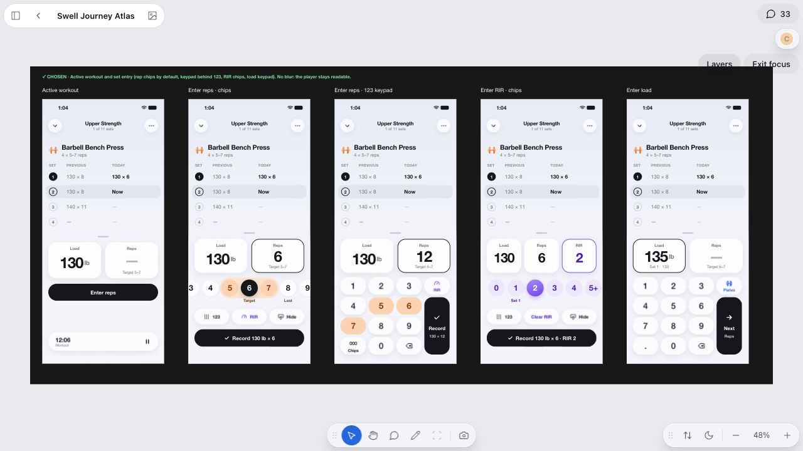
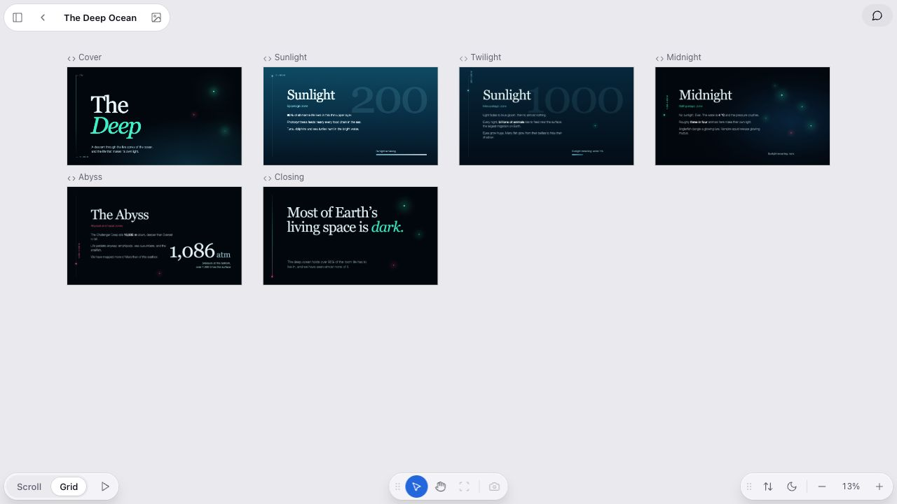

# Screens

A local canvas where you and your coding agent create, arrange, and comment on HTML designs. Works with Codex and Claude Code.



Compare design directions, interact with prototypes, and leave comments for your agent. Add reference images, edit layers, or build a presentation or document.



## Install

Requires Node.js 24 or later and Chrome or Chromium for previews. Start with Codex or Claude Code already installed and configured.

```sh
git clone https://github.com/rishirsv/screens.git
cd screens
npm ci
npm run release:plugins
```

Install in your host.

### Codex

```sh
codex plugin marketplace add "$HOME/.local/share/screens/marketplace"
codex plugin add screens@screens-local
```

Open Screens from the sidebar or as a chat tab.

### Claude Code

```sh
claude plugin marketplace add "$HOME/.local/share/screens/marketplace"
claude plugin install screens@screens-local
```

Ask Claude to open Screens in its browser pane or your system browser.

Try this prompt:

> Design three directions for a sign-in screen in Screens.

Leave a comment on a design, then ask your agent to address it.

## Local data

Screens stores its library in `~/.screens`. Set `SCREENS_HOME` to use another folder. Your agent provider may receive prompts, tool calls, and results.

## Run from source

```sh
npm ci
SCREENS_HOME=.screens-dev npm start
```

Open the URL the service prints. The checkout's `.mcp.json` connects your agent to the development library.

```sh
npm run typecheck
npm run release:build
npm run release:verify
```

Repository skills live in [`.agents/skills`](.agents/skills). This project does not accept contributions or pull requests.

## License

[MIT](LICENSE). Third-party notices ship with the release package.
